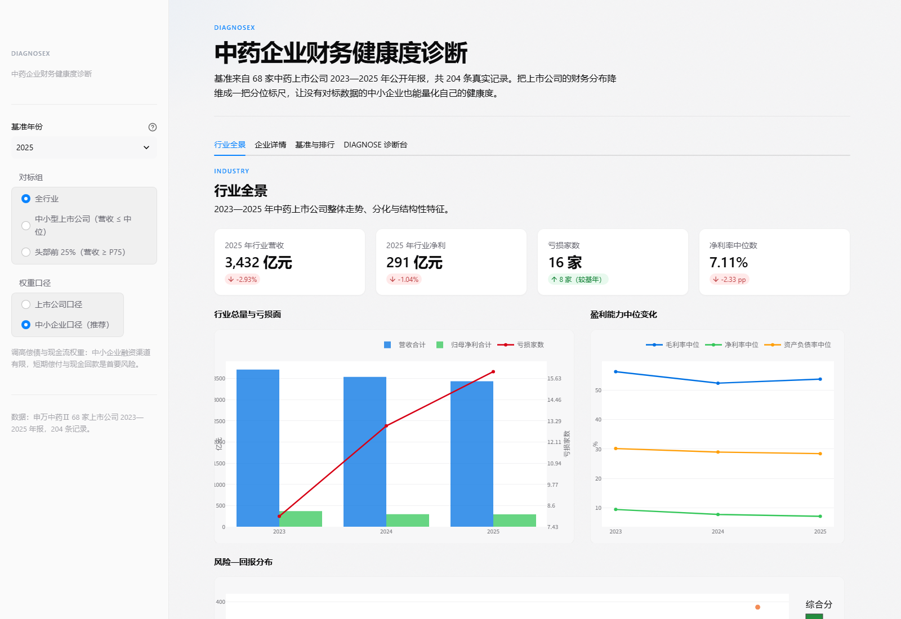

# DIAGNOSEX

> 面向中医药企业的财务诊断工具
> A financial diagnostic toolkit for TCM (traditional Chinese medicine) enterprises

**DIAGNOSEX** 用 A 股中药上市公司公开年报构建行业分位标尺，把一家企业放进行业坐标系里，直接回答三个问题：**企业处于行业什么位置、哪些指标拖了后腿、整改后能到什么水平。**

名字取自 **Diagnose + X**：X 是待诊断的未知企业，也取自医学影像的 X 光——透视企业财务骨骼；-EX 亦指 Expert / Expertise，把上市公司的公开经验转化为可复用的专家级判断。

## 界面一览



---

## 它解决什么问题

中医药企业（尤其是中小型企业）做财务自查时，普遍缺一套行业参照系：

- 财务人员能算出自己的毛利率是 18%，但**不知道这在中药行业里算好还是算差**；
- 通用的行业均值（如"中药行业平均毛利率 40%"）掩盖了巨大的结构性差异，参考价值低；
- 头部企业与中小企业在偿债、现金流上的风险特征完全不同，用同一把尺子衡量会失真。

DIAGNOSEX 的做法是：**不给你一个绝对分数，而是给你一个行业分位位置**，并针对企业规模匹配对应的对标组与权重口径。

## 核心方法

### 1. 行业分位标尺（核心发明）

以申万中药Ⅱ 板块 **68 家上市公司 × 2023—2025 年 = 204 条公开年报记录**为样本，对 10 项核心指标分别计算 P10 / P25 / P50 / P75 / P90 分位点，构建分位标尺。

**企业某项指标的得分 = 分位标尺上做分段线性插值**

这样得到的是"击败了行业多少比例的公司"的相对位置，而不是拍脑袋的绝对分数线。标尺可随样本替换而迁移，模型无需重构。

### 2. 十项指标 → 六大维度

| 维度 | 指标 | 方向 |
|---|---|---|
| 盈利能力 | 毛利率、净利率、ROE | 正向 |
| 成长能力 | 营收增速、净利增速 | 正向 |
| 偿债能力 | 资产负债率 | **逆向** |
| 营运能力 | 总资产周转率 | 正向 |
| 现金流质量 | 经营现金流利润率、净利现金含量 | 正向 |
| 研发投入 | 研发费用率 | 正向 |

### 3. 分层对标组 + 双口径权重

不同规模企业的财务结构差异极大，因此不共用一套标准：

| 对标组 | 划分依据 | 样本数 |
|---|---|---|
| 全行业 | 全部样本 | 68 家 |
| 中小型 | 营收 ≤ 行业中位数（19.55 亿元） | 34 家 |
| 头部 | 营收 ≥ P75 | 17 家 |

权重口径也分两套：

| 维度 | 上市公司口径 | 中小企业口径 |
|---|---|---|
| 盈利 | 20 | 24 |
| 成长 | 15 | 12 |
| 偿债 | 20 | **28** |
| 营运 | 15 | 14 |
| 现金流 | 20 | **18** |
| 研发 | 10 | 4 |

中小企业口径把偿债与现金流的权重显著提高——因为它们抗风险能力弱，这两项才是生死线。

### 4. 五档评级

优秀 ≥ 70 ｜ 良好 ≥ 60 ｜ 一般 ≥ 50 ｜ 关注 ≥ 40 ｜ 风险 < 40

### 5. 规则引擎与情景模拟

诊断出短板后，工具会给出结构化的改进路径，并支持情景模拟：修改某项指标的假设值，实时看到综合评分的变化，用于评估整改投入的优先级。

---

## 快速开始

### 方式一：网页版（零依赖，推荐先试）

直接用浏览器打开 `DIAGNOSEX_单文件版.html`。单文件、纯前端、离线可用，无需安装任何环境，不上传任何数据。

### 方式二：完整版（含批量诊断与报告导出）

```bash
git clone https://github.com/<your-name>/DIAGNOSEX.git
cd DIAGNOSEX

pip install -r requirements.txt
streamlit run DIAGNOSEX.py
```

Windows 用户可以直接双击 `run_DIAGNOSEX.bat`，脚本会自动创建虚拟环境、安装依赖并启动，浏览器将自动打开 `http://localhost:8502`。

依赖仅三项：`streamlit`、`pandas`、`plotly`。

### 方式三：给出企业数据做诊断

在"诊断台"录入企业财务数据，得到综合评分、评级、六维度得分、行业分位定位与改进建议。支持单家录入与 CSV 批量上传（UTF-8 / GBK 均可）。

---

## 四个页签

| 页签 | 内容 |
|---|---|
| 基准与排行 | 68 家上市公司健康度排名、评级、领先榜与待改善榜 |
| 企业详情 | 单家公司三年财务走势、六维度雷达、逐项指标行业分位 |
| 行业全景 | 三年总量趋势、盈利中位数、亏损面、风险—回报散点 |
| DIAGNOSE 诊断台 | 中小企业录入数据 → 评分 / 评级 / 改进建议 / 情景模拟 / 报告 |

---

## 数据说明

`中药上市公司2023-2025年报财务数据.csv` 为申万中药Ⅱ板块 68 家上市公司 2023—2025 年的公开年报数据，共 204 条记录，字段包括营收、利润、毛利率、ROE、资产负债率、现金流、研发费用等。

- 数据来源：上市公司公开披露的年报
- 样本口径：68 家用于构建分位标尺，其中 66 家纯中药标的进入评分排行
- 数据仅含企业财务指标，**不含任何个人信息**

若要用到其他行业或其他板块，直接替换该 CSV 并保持列名一致即可，模型本身无需修改——这正是"标尺 + 权重"方法相对于硬编码评分表的价值所在。

---

## 项目结构

```
DIAGNOSEX/
├── DIAGNOSEX.py                              # 主程序（Streamlit，约 1800 行）
├── DIAGNOSEX_单文件版.html                    # 零依赖离线单文件版
├── 中药上市公司2023-2025年报财务数据.csv        # 68 家 × 3 年 = 204 条公开年报数据
├── requirements.txt                          # streamlit / pandas / plotly
├── run_DIAGNOSEX.bat                         # Windows 一键启动
├── .streamlit/
│   └── config.toml                           # 主题配置
├── docs/
│   └── 界面_行业全景.png                      # 界面截图
├── LICENSE
└── README.md
```

---

## 方法学验证

工具输出与市场公开信息做过交叉对照，三个口径分别如下（口径不同，不宜混用）：

| 验证项目 | 结果 | 说明 |
|---|---|---|
| 总体评级一致率 | **73.5%** | 50/68，与市场客观判断交叉对照 |
| 风险企业识别准确率 | **94.4%** | 17/18 |
| ST / \*ST 企业识别率 | **100%** | 6 家全部识别 |

作为对照组，常用的均值 z-score 法与本项目方法评级一致率仅 57.4%，且呈现**系统性偏乐观**：把 40 家企业挤入"一般"档、0 家达到"良好"、漏报 4 家风险企业（含 1 家 ST）。这说明单纯用均值和标准差会抹平行业内部的结构性差异。

---

## 免责声明

本工具基于上市公司公开年报数据构建行业分位基准，输出结果仅供企业内部管理参考与学术研究使用，**不构成审计意见、财务鉴证或投资建议**。使用者应结合企业实际情况独立判断。

---

## 作者

胡启铭 · 山东现代学院

## 许可

[MIT License](LICENSE) — 可自由使用、修改、分发，保留版权声明即可。
